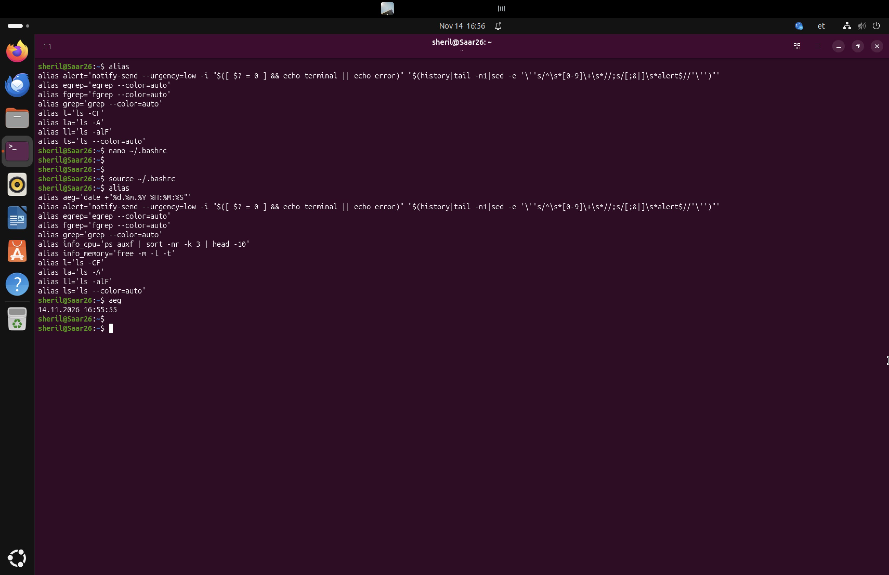

## Praktikum 9

Ülesanne 9-1: 
/home/sheril

Ülesanne 9-2:

Ülesanne 9-3:
Eemaldasin Ubuntu virtuaalmasinast CUPS-i, sest see on mõeldud printerite ja printimistööde haldamiseks, kuld ma ei kasuta virtuaalmasinas printimist. Seega ei ole tarkvara mulle vajalik ning selle eemaldamisega sain vabastada 1577 kb kettaruumi.

